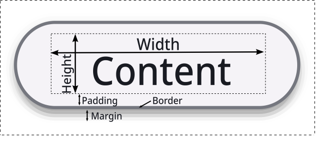

+++
Categories = ["Architecture"]
+++

**Layout** is the process of sizing and positioning [[widget]]s in a [[scene]], according to the [[styles#layout|layout styles]] on each widget. Each [[frame]] widget performs the layout of its child widgets, recursively, under the control of the overall [[scene]].

Each [[doc:core.WidgetBase]] has a [[doc:core.WidgetBase.Geom]] field that contains the results of the layout process for each widget.

The layout process involves multiple passes up and down the [[doc:tree]] of widgets within the [[scene]], as described below.

## Sizing

Determining the proper size of a given widget involves both _bottom-up_ and _top-down_ constraints:

* Bottom-up constraints come from the `Min` and `Max` [[styles#layout|layout styles]], and the size needed by [[text]] elements to fully display the relevant text, styled according to the [[style]] settings.

* Top-down constraints come ultimately from the size of the window containing the [[scene]] in which the content is being displayed, and are propagated down from there to all of the [[frame]] elements in the scene. Each frame gets an _allocation_ of space from above, and then allocates that space to its children, on down the line.

To satisfy these constraints, multiple passes are required as described below. 

The final result of this process is represented in two key variables in the `Geom` state:

* **Actual** represents the actual pixel size for a given widget. This is the territory it "owns" and can render into.

* **Alloc** is the amount allocated to the widget from above.

Critically, the _positioning_ of widget elements within their parent frame is based on their `Alloc` size. For example, a `Grid` display type will allocate each element in the grid a regularly-sized rectangle box, even if it doesn't need the whole space allocated to render (i.e., its `Actual` may be smaller than its `Alloc`). To keep these elements positioned regularly, the alloc sizes are used, not the actual sizes.

There are also two different values for each size, according to the box model:

* **Content** represents the inner contents, which is what the style Min and Max values specify (unless [[doc:styles.Style.BoxSizing]] is [[doc:styles.BoxBorderBox]]), and has the height and width shown in the above figure.

* **Total** represents the full size including the padding, border and margin spacing.

The three types of passes are:

### SizeUp

This is the _bottom-up_ pass, from terminal leaf widgets up to through their container frames, and sets the `Actual` sizes based on the styling and text "hard" constraints, along with the intrinsic widths of each widget (see [[#intrinsic widths]]).

### SizeDown

This is the _top-down_ pass, which may require multiple iterations. It starts from the size of the [[scene]], and then allocates that to child elements based on their `Actual` size needs from the `SizeUp` pass.

If there is extra space available, it is allocated according to the `Grow` styling factors. This is what allows widgets to fill up available space instead of only taking their minimal bottom-up needs. If there is too little space, the widths of elements with a `Shrink` factor are reduced to fit (see [[#shrinking]] below).

Flexible elements (e.g., Flex Wrap layouts and Text with word wrap) update their Actual size based on the available Alloc size (re-wrap), to fit the allocated shape vs. the initial bottom-up guess.

It is critical that no elements actually Grow to fill the Alloc space at this point: the `Actual` must remain as a _minimal_ "hard" requirement throughout this process. Alloc is only used for reshaping, not growing.

If any of the elements changed their size at this point, e.g., due to re-wrapping, then another iteration is taken. Re-wrapping can also occur if a scrollbar was added or removed from an internal frame element (if it has an `Overflow` setting of `styles.OverflowAuto` for example).

### SizeFinal

SizeFinal: is a final bottom-up pass similar to SizeUp, but now with the benefit of allocation-constrained `Actual` sizes.

For any elements with Grow > 0, the `Actual` sizes can grow up to their `Alloc` space. Frame containers 
accumulate these new actual values for use in positioning.

## Positioning

The `Position` pass uses the final sizes to set _relative_ positions within their containing widget (`RelPos`) according to the `Align` and `Justify` [[styles]] settings.

Critically, if `Actual` == `Alloc`, then these settings have no effect! It is only when the actual size is less than the alloc size that there is extra "room" to move an element around within its allocation.

The final `ApplyScenePos` pass computes scene-based _absolute_ positions and final bounding boxes (`BBox`) for rendering, based on the relative positions. 

This pass also incorporates offsets from scrolling, and is the only layout pass that is required during scrolling, which is good because it is very fast.

## Finer points

The following sections describe some details of the layout logic that matter when building more complex layouts, many of which follow the corresponding CSS behavior, as needed to render HTML pages in [[html]].

### Max limits the content

`Max` is the maximum size of the content box, like `Min`, so the padding and border are added to it for the total size. A widget with `Grow` grows up to its `Max` content size, and if it is allocated more than that, the extra space around it is used for its alignment within its allocation (see [[#positioning]]).

With a [[doc:styles.Style.BoxSizing]] of [[doc:styles.BoxBorderBox]], `Min` and `Max` instead include the padding and border, as with `box-sizing: border-box` in CSS.

### Growing within frames that do not grow

A frame can be allocated more space than its own `Actual` size: for example, the width of a column in a grid is that of its widest element, which is allocated to every element in the column. A frame that does not grow in a given dimension only gives its children that grow the space within its own actual size, so that they fill the frame but do not grow beyond it. Children that wrap their content within all of the space that they can have (centered [[text]], with `GrowWrap`) still get all of the allocation to wrap within.

### Intrinsic widths

Widths are _intrinsic_ and heights follow from them, as in CSS. In `SizeUp`, each widget computes two widths: its _min-content_ width, below which its content overflows (the width of the longest word of [[text]]), and its _max-content_ or preferred width, its width without any wrapping (the width of text on one line). Frames combine those of their children for their layout: a row sums them, a column takes the largest of each, a wrapped row takes the largest minimum and the sum of the preferred widths, and a grid does each per column. A frame that scrolls in width has no minimum of its own, as its content scrolls.

A widget starts out at its preferred width, within the width allocated to it, and is narrowed toward its minimum only when there is too little room. Its height is that of its content at the width that it is finally given, so text wraps where it needs to, and stays on one line when it fits. A frame that scrolls only scrolls in width if its content is wider than it at its minimum. When a window or dialog is sized to fit its content, the preferred width of text is limited to a readable measure of 70 characters, within which it wraps, so that the window is not as wide as a long text on one line.

### Shrinking

[[doc:styles.Style.Shrink]] is the counterpart of `Grow` for when there is too little space, like `flex-shrink` in CSS, and currently only applies to widths. Every widget that can be narrower than its preferred width shrinks, with a factor of 1 unless `Shrink` says otherwise. During `SizeDown`, if the children of a row (or the columns of a grid) are wider than the allocated width, the columns are narrowed in proportion to their `Shrink` factor and their width, but never below their min-content width. A column that grows up to a `Max` (as for a width in CSS) starts from that `Max`, so that columns with the same `Max` shrink to the same width, as for the flex basis of CSS.

The children of a column are at most as wide as the column. A frame in a column is narrowed to the width of the column even below its minimum, so that its content then overflows it (as a block in CSS), while other widgets, such as text, are not narrowed below their minimum, which keeps the words of text whole. The items of a wrapped row are not narrowed below their minimum.

### Grids

Grid elements can span multiple columns ([[doc:styles.Style.ColSpan]]) and rows ([[doc:styles.Style.RowSpan]]). The columns and rows are first sized by the elements that do not span, and then those that an element spans are widened (or heightened) evenly to fit it, if they are smaller together than it. The cells after an element that spans rows are placed in the columns after it in the rows below.

### Justify spacing

The `Justify.Content` values of [[doc:styles.SpaceBetween]], [[doc:styles.SpaceAround]] and [[doc:styles.SpaceEvenly]] distribute the extra space along the main axis between the elements, as in CSS, in each line of a wrapped layout.

### Scrolling

A frame with an [[doc:styles.Style.Overflow]] of [[doc:styles.OverflowAuto]] gets scrollbars only when its content is larger than its allocation, which reduces the space for its content, and can require another `SizeDown` iteration to re-wrap. When a window is first opened, it is sized to fit the content of its scene: in that computation, the scene itself never adds scrollbars, as it is sized to its content by definition. Scroll offsets are always whole dots, so that the content is rendered crisply.

### Positioned widgets

A widget with a [[doc:styles.Style.Position]] other than the default [[doc:styles.PositionStatic]] is positioned by its [[doc:styles.Style.Inset]], like the `position` property of CSS:

* [[doc:styles.PositionRelative]] is laid out normally, and then offset by its inset in the `Position` pass, without changing the layout of the widgets around it.

* [[doc:styles.PositionAbsolute]] is out of the flow of the layout of its parent: it is sized like the other children, but takes no space in its parent, and is positioned by its inset relative to its _containing block_, which is the nearest widget that it is in that is not static (or that scrolls). If both opposite sides of its inset are set (as in [[doc:styles.Style.InsetSet]]), it fills the space between them in that dimension.

* [[doc:styles.PositionFixed]] is like absolute, but relative to the scene, so that it does not scroll.

### Floats

A widget with a [[doc:styles.Style.Float]] floats to the left or right side of its parent, which must be a column (`Flex` direction `Column` without wrap), like the `float` property of CSS. It is out of the flow of the column, at the position where it is, and each widget after it that starts beside it is narrowed and moved to be beside it. This is a simplification of CSS floats, in which each line of text beside a float is shortened instead. [[doc:styles.Style.Clear]] moves a widget below the floats on the given sides, and the column is as tall as its floats. Floats are laid out during `SizeDown`, as they affect the allocations of the widgets beside them, and positioned in the `Position` pass.

### Clipping and render order

By default, each frame clips the rendering of its children to its content box. With [[doc:styles.Style.NoClip]], its children are clipped by the nearest frame that it is in that does clip (or scrolls) instead, as with content that overflows a box in CSS.

Children are rendered in order, except that floating children are rendered after the others (on top of their backgrounds), and positioned (non-static) children after those, in increasing order of their [[doc:styles.Style.ZIndex]] (with negative values rendered first, underneath). Events go to the widget that is rendered on top at a given point.

### Spacing

The `Gap`, `Margin` and `Padding` of widgets are scaled by the [[doc:core.AppearanceSettingsData.Spacing]] setting (60% by default on desktop platforms, and 100% on mobile), so that the overall density of the layout can be adjusted. Use [[doc:core.ConstantSpacing]] for sizes that should not be scaled.

## Links

* [Flutter](https://docs.flutter.dev/resources/architectural-overview#rendering-and-layout) uses a similar strategy for reference.

* [stackoverflow](https://stackoverflow.com/questions/53911631/gui-layout-algorithms-overview) has a discussion of layout issues.
