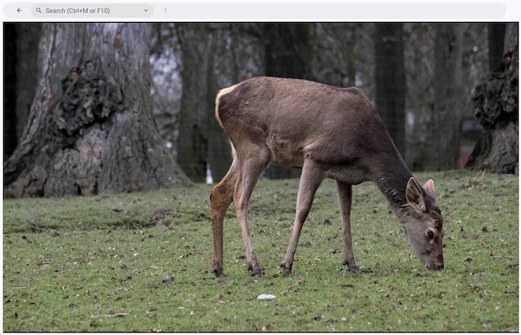

+++
Categories = ["Widgets"]
+++

A **video** is a [[widget]] for playing video and audio media ([[doc:core.Video]]). Video support is currently experimental. On desktop platforms, videos are decoded with [FFmpeg](https://ffmpeg.org), which you must first install with `core setup -video` (see [[install]]). On the web, a video is played by the browser; files of an app such as its videos can be served with it with `Web.Files` in its `core.toml` (as in the [video example](https://github.com/cogentcore/core/tree/main/examples/video)), so that it opens them by their relative paths.

For static images, use an [[image]] widget instead. For more programmatic control of rendering, use a [[canvas]]. For SVG, use an [[SVG]] widget.

You can make a new video widget, open a video file, and play it:

```go
v := video.NewVideo(b)
v.Styler(func(s *styles.Style) {
    s.Grow.Set(1, 1)
})
errors.Log(v.Open("video.mp4"))
v.OnShow(func(e events.Event) {
    v.Play(0, 0)
})
```

Here is a screenshot of the [video example](https://github.com/cogentcore/core/tree/main/examples/video):


